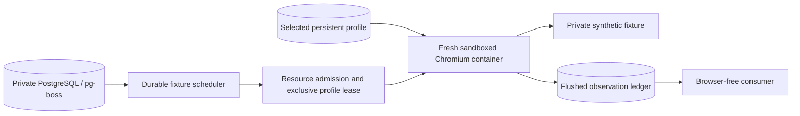

# PasarPilot

PasarPilot is a planned self-hosted trading assistant for sellers in Facebook buy/sell communities, initially the Malaysian Magic: The Gathering community. Buyers would continue using comments and Messenger; sellers would manage listings, claims, conversations and fulfilment from a native dashboard.

**Current status:** the synthetic seller application supports inventory/WTS listings, claims/backups, conversations, seller-confirmed payment, fulfilment and retained history. It now includes guided onboarding, responsive light/dark navigation, guarded actions, bounded pagination/activity checks and a repeatable RM10 demonstration. The browser-lifecycle experiment and single-slot fixture scheduler remain separate protected boundaries.

The seller-usability milestone has **30/32 tasks complete**. All 240 clean synthetic sales succeeded, but Jarlaxle's resource gate failed on host swap-out growth before both settled windows completed. A native screen-reader pass is unavailable, and the current prepared-host fixture regression is blocked by host name resolution. This is not production-readiness or live Meta authorization. See the [acceptance report](docs/research/seller-usability-acceptance.md) and [setup/demo/recovery guide](docs/operations/seller-workspace.md).

## Architecture direction

Use a bounded pool of short-lived, tenant-isolated Chromium processes with seller-specific profiles stored securely between visits. Start with one slot, admit work against measured host headroom, and verify complete browser termination before releasing a profile. Keep deterministic business processing and any later AI interpretation outside browser occupancy.



The seller application and trading worker run without a browser or permanently running remote desktop. Optional capture retains the existing isolated browser boundary. Temporary headed sessions consume separately admitted capacity. PostgreSQL/pg-boss backs both separate synthetic queues; production integration and selective OpenRouter inference remain future work.

## Completed experiment

OpenSpec change: [`benchmark-bounded-browser-lifecycle`](openspec/changes/benchmark-bounded-browser-lifecycle/proposal.md). All 27 tasks are complete; the change remains available for review and has not been archived.

Measured on Jarlaxle on 2026-10-27, with approximately 7.1 GiB usable RAM and Minecraft stopped with owner approval:

| Measurement | Result |
| --- | ---: |
| Continuous control / fresh-process rotation | 100/100 visits passed in each arm |
| Rotation mean / p95 complete visit | 2.316 / 2.357 seconds |
| Rotation / continuous whole-attempt peak | 281.55 / 418.45 MiB |
| Calibrated fixture allowance per slot | 576 MiB |
| Available-memory deterioration after rotation | 13.50 MiB; within the 256 MiB tolerance |
| One-slot calculated capacity at 70% utilisation | Approximately 1,088 fixture checks/hour |
| Automated / final recovery tests | 14/14 and 16/16 passed |

**Decision: GO for a single-slot fixture scheduler next.** Two/four-worker short experiments and temporary noVNC access also passed. Higher concurrency figures are limited batch measurements; the throughput figure is a projection, not a sustained production result. These synthetic results do not establish Facebook/Messenger reliability, customer capacity or a subscription SLA.

All experiment containers and their private network were removed after measurement. Retained raw evidence and synthetic profiles stay outside Git. Minecraft was left stopped at experiment cleanup; future host changes require a fresh resource baseline.

## Completed fixture scheduler

OpenSpec change: [`schedule-bounded-fixture-visits`](openspec/changes/archive/2026-10-27-schedule-bounded-fixture-visits/proposal.md). It adds durable jobs, round-robin tenant turns, coalescing/backpressure, cancellation, restart reconciliation and browser-free consumption while retaining one admitted browser slot.

On Jarlaxle, **102/102 planned clean visits passed**, 34 per tenant, with no retries. Mean/p95 occupied time was **2.387/2.461 seconds**; browser peak was **298.80 MiB**, and concurrent database plus scheduler memory peaked at **147.56 MiB**. All 19 unit tests, three database integration tests and 16 controlled recovery cases passed. See the [measured scheduler evidence and limitations](docs/research/bounded-fixture-scheduling.md) and [runbook](benchmark/README.md#durable-single-slot-fixture-scheduler).

Fixture reset can change its origin and invalidate stored authentication/history; recovery refuses missing markers and retains uncertain actions. This result covers one synthetic host/slot, with raw evidence retained privately outside Git.

## Local development checks

Use Node.js 20 or newer, as declared by the benchmark package. The measured host used Node.js 22.23.4; the Playwright image used Node.js 24.22.1. No browser or container runtime is needed for these checks:

```sh
cd benchmark
npm ci
npm run check
npm test
```

Browser execution requires a prepared Linux host with rootless Podman, cgroup v2 and working Chromium sandbox support. Follow the [benchmark runbook](benchmark/README.md) for those experiments. The [seller guide](docs/operations/seller-workspace.md) starts the authenticated application on `127.0.0.1:8787` using a selected private PostgreSQL dataset.

## Documentation

- [Seller usability acceptance, tests, failed gates and commit ledger](docs/research/seller-usability-acceptance.md)
- [Invited-seller setup, browser-only RM10 demonstration, backup/restore and recovery](docs/operations/seller-workspace.md)
- [Original assisted trading-core evidence](docs/research/assisted-wts-trading-core.md)
- [Measured results, decision gates, limitations and implementation commits](docs/research/bounded-browser-lifecycle.md)
- [Durable fixture scheduler results, recovery evidence and limitations](docs/research/bounded-fixture-scheduling.md)
- [Capacity, queue latency and cost trade-offs](docs/research/bounded-browser-capacity.md), including the [864-scenario projection matrix](docs/research/bounded-browser-capacity.csv)
- [Sanitised Facebook UI observations and unresolved assumptions](docs/research/facebook-ui.md)
- OpenSpec [proposal](openspec/changes/benchmark-bounded-browser-lifecycle/proposal.md), [design](openspec/changes/benchmark-bounded-browser-lifecycle/design.md), [lifecycle requirements](openspec/changes/benchmark-bounded-browser-lifecycle/specs/bounded-browser-lifecycle/spec.md), [resource requirements](openspec/changes/benchmark-bounded-browser-lifecycle/specs/browser-resource-benchmark/spec.md) and [completed tasks](openspec/changes/benchmark-bounded-browser-lifecycle/tasks.md)

## Product and security boundaries

The implemented synthetic workflow runs from WTS claims through seller-confirmed payment and collection, with deterministic optional negotiation, inventory, onboarding and dashboard controls. AI, billing, live Facebook/Messenger and real banking integrations remain excluded.

- Meta authorisation remains an unresolved release gate. Seller permission alone does not authorise Facebook automation; no production Facebook automation runs here.
- Sellers must authenticate directly in their own isolated session. PasarPilot must not collect Facebook passwords or history-unlock PINs through its dashboard.
- Hosting authenticated profiles exposes account sessions to a privileged host operator. The prototype's filesystem permissions and containers are not a complete production encryption, access-control or remote-access design.
- A payment screenshot alone must never mark an order paid. Verification needs seller approval after checking a trusted account or a trusted payment provider.
- Keep real credentials, profiles, messages and raw browser artifacts out of Git. Do not expose CDP, VNC or container-management endpoints publicly.

The scoped `schedule-bounded-fixture-visits` change is implemented and validated. Real-platform integration and higher production concurrency still require separate approval and evidence.
