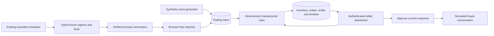

## Context

The [browser benchmark](../benchmark-bounded-browser-lifecycle/specs/bounded-browser-lifecycle/spec.md) and its [resource specification](../benchmark-bounded-browser-lifecycle/specs/browser-resource-benchmark/spec.md) establish sandboxing, profile ownership and verified termination. It is complete but remains unarchived in this checkout. The [archived scheduler design](../archive/2026-10-27-schedule-bounded-fixture-visits/design.md) and [main scheduler spec](../../specs/bounded-fixture-scheduling/spec.md) add durable, fair single-slot scheduling. Read the [lifecycle results](../../../docs/research/bounded-browser-lifecycle.md), [scheduler results](../../../docs/research/bounded-fixture-scheduling.md) and [sanitised UI research](../../../docs/research/facebook-ui.md) as evidence, not proof of permitted or reliable Facebook automation.

The current implementation is a Node 20+/TypeScript workspace in `benchmark/`, with pinned PostgreSQL 17.11, `pg`, `pg-boss` and Playwright. `scheduler-store.ts` demonstrates short transactions and claim fencing; `events.ts` flushes a version-1 observation ledger and `visit.ts` releases Chromium before consumption. Those observations contain source counters and event counts, not buyer claim text or parent relationships. No dashboard, seller login or trading domain exists yet.

## Goals / Non-Goals

**Goals:** A seller can manage inventory/listings and complete a synthetic sale safely, see competing claims and conversation context, review ambiguity, approve deterministic replies, verify received payment and record fulfilment. Prove isolation with two sellers and concurrency with real database connections.

**Non-Goals:** Live Facebook reads/writes, payment gateways or screenshot verification, WTB, billing, autonomous negotiation, catalog/image recognition, multi-item carts, cross-seller checkout, public onboarding and production hosting. One listing can contain several item comments, but each claim/order covers one item variant and a positive quantity. OpenRouter is optional future interpretation work and has no role in stock, price, priority or payment decisions here.

## Decisions

### 1. Extend the existing workspace, not the browser scheduler's responsibilities

Add focused modules under `benchmark/src/trading/`, a trading entry point and separate test commands. Reuse pinned database packages, transaction conventions and Node facilities. Keep the existing benchmark/scheduler commands, schema identities, 400-event counting contract, leases, slot ceiling and control modes working. Do not rename the workspace, add an ORM, introduce another database/message broker or build a frontend application framework for this demonstration.

Use one small server-rendered Node HTTP application and a browser-free worker, started together for the demo. The worker uses separate application pg-boss queues/schema for inbox processing and expiry wake-ups; these jobs never acquire browser profiles or consume browser slots. PostgreSQL holds domain truth. Queue delivery is a wake-up/retry mechanism, not an inventory lock or a second order-state authority.

### 2. A small authenticated workspace with explicit tenant boundaries

An operator creates two independent seller accounts through a local command; no registration, email service or account-recovery product is added. Hash passwords with salted asynchronous Node `scrypt`; use random opaque session tokens, store only their hashes, rotate on login and expire/revoke on logout. Apply bounded login throttling and generic failure messages. Session cookies are HttpOnly and SameSite=Strict; require CSRF tokens and same-origin checks for state-changing forms, and escape all rendered user/source text. [Node crypto](https://nodejs.org/docs/latest-v20.x/api/crypto.html) and [OWASP CSRF guidance](https://cheatsheetseries.owasp.org/cheatsheets/Cross-Site_Request_Forgery_Prevention_Cheat_Sheet.html) cover the underlying mechanisms.

Bind the demo to loopback, accessed locally or through an SSH tunnel. HTTPS deployments require Secure cookies; the explicit loopback HTTP demo is not a public deployment mode. Credentials and session tokens never enter logs, fixtures, browser profile mounts or Git. Use a restricted application database role, not the fixture bootstrap superuser, for normal requests.

Every domain read/write derives `seller_id` from the authenticated session or an operator-established fixture mapping. Never trust a seller ID submitted in a form/event body. Qualify SQL by seller; use composite `(seller_id,id)` parent keys/foreign keys to prevent cross-seller links. Foreign IDs return no data. Test two sellers using colliding source/buyer/item identifiers, including jobs, review actions, histories and simulated replies. Browser tenant labels remain the existing allowlist; two application accounts map explicitly to two synthetic fixture tenants without widening browser access.

### 3. Explicit inventory and listing identities

An inventory row records card name, set/printing identifier, collector number, language, finish/variant label, condition, unsold quantity, reserved quantity, asking price and an optional minimum acceptable unit price. Use manual metadata and explicit condition/variant choices; no external catalog, CKD conversion, image interpretation or fuzzy matching. Distinct printings, finishes or conditions never share stock accidentally.

Money is nonnegative integer MYR sen. Validate decimal input, positive integer quantities and arithmetic bounds at the boundary; use checked integer/widened database arithmetic and reject overflow or fractional sen before writes. Do not use floating-point rounding for agreement totals. An order snapshots variant, condition, quantity, agreed unit price, fulfilment fee and relevant policy versions; later inventory/listing edits do not reprice it.

A WTS listing has a synthetic post ID, open/closed state and seller-authored item comments. Each item comment maps to exactly one inventory row and has its own offered quantity, asking-price snapshot and revision. Several listings can reference one inventory row, so both global available stock and the listing item's remaining offered allocation are checked. Editing quantity cannot reduce unsold stock below active holds or an offered allocation below its held/committed quantity; offer closure prevents new allocations without silently cancelling existing orders.

### 4. Normalized events and an honest fixture handoff

Define a versioned envelope containing source/fixture epoch, seller mapping, stable event/object ID, source revision, reliable stream position, event kind, buyer actor ID, post/item/parent/thread references, source time and bounded payload. Event kinds cover item replies, buyer messages, price offers and reported payment evidence. Keep source time separate from receipt/processing time. A fixture generator supplies authoritative positions and stable actor IDs; display names cannot prove buyer identity.

Persist an inbox row and its application queue wake-up atomically. Uniqueness on seller/source/epoch/event/revision prevents duplicate effects; conflicting payloads for the same identity are quarantined. Process reliable stream positions in order under a stream cursor lock; buffer gaps or missing parents rather than award a later claim. Unknown ordering or an edit/deletion of an already acted-on claim opens review; it never silently revokes a hold, changes an agreed price or applies another claim. Review resolution records the seller, reason and affected revision.

The direct synthetic generator exercises this same boundary without Chromium. For the browser-backed demonstration, add an opt-in WTS fixture payload capture: actual typed events returned by the controlled fixture are flushed to an attempt sidecar alongside the unchanged aggregate ledger. Only after verified termination/profile release does an importer write those events into the trading inbox. Re-scan completed handoffs on restart and deduplicate after import/acknowledgement crashes. Never invent semantic events from `eventCount=400`, nor infer an empty/complete source from missing payload/history. Existing non-trading visits keep their current workload and output contract.

### 5. Claim rules and atomic allocation

Recognise only the documented exact grammar `claim [positive quantity]` and `backup [positive quantity]`, case-insensitive with quantity one when omitted, against a known item parent and stable actor. Questions remain inquiries. Conditional, mixed-item, contradictory or unclear claims open review with no stock effect. Review can bind item/buyer/quantity and create an explicit interpreted claim using current availability; it cannot bypass reservation rules or silently displace a valid hold. Unconfirmed ambiguous claims receive no automatic entitlement to stock.

A clear claim becomes primary only if the complete quantity fits. Otherwise it becomes a queued backup. An explicit backup is standby and does not reserve on arrival. A distinct repeated claim by a buyer with an active order for that item goes to review rather than adding quantity. Rank eligible backups by reliable source position, then stable ID; never claim real Facebook chronological certainty. On an unpaid release, automatically promote the earliest fully fillable backup for the same open listing item, creating a fresh hold and proposed notification. Backups on other item comments remain visible for seller-initiated promotion through the same stock guards; there is no invented cross-listing priority order. No partial fills or automatic multi-item orders are introduced. Exhausted sold listings resolve remaining backups as unfulfilled; restocking does not resurrect old claims automatically.

For allocation, lock the seller's inventory row, then listing item and affected order/reservation rows in a consistent order. Reconcile expired holds under those locks. Check `available = unsold - reserved`, listing remaining quantity and unique active claim/order constraints; increment reserved, create order/hold, record inbox result, draft and timeline in one short transaction. Database constraints enforce `0 <= reserved <= unsold`. Roll back everything on failure. [PostgreSQL row locks](https://www.postgresql.org/docs/17/explicit-locking.html#LOCKING-ROWS) serialize competing updates; in-memory checks and browser locks do not protect business stock.

Default unpaid holds last 15 minutes by database time. Cancellation/expiry releases stock once and promotes backups in the same transaction. An explicit seller extension requires a still-live hold, current version and future deadline, bounded to 24 hours from the action; an expired hold needs fresh allocation. Queue expiry jobs are idempotent wake-ups: startup/periodic sweeps and every stock/payment mutation check actual database time, so downtime or a missed job cannot preserve an expired right to buy. A payment/expiry race is serialized on the same rows.

### 6. Conversations, responses and bounded negotiation

Persist buyer/thread identity, message source references, item/order associations and unresolved context. Parent IDs and explicit validated mappings determine item association; an inquiry in a thread with several possible items/orders is a review task, not a guess from a display name. Keep unrelated text visible only in its scoped conversation, without inventory/payment effects.

Use fixed templates for claim acknowledgement, backup position, stock availability, clarification, price response, payment request and fulfilment confirmation. Store a draft with the versions of its source, order, listing and seller policy. Seller approval rechecks those dependencies, current hold and amount before simulated delivery. Changed/revoked dependencies make a draft stale; approval cannot send an outdated price or payment instruction. Duplicate approval/delivery produces one outbound record through a unique draft ID.

Negotiation is disabled unless a seller configures a minimum unit price no higher than asking. An explicit offer at/above that minimum can produce an acceptance proposal; below it, propose a polite decline or asking-price counter without exposing the private minimum. Acceptance still requires seller approval and atomic allocation/price validation. Inquiries/offers alone do not reserve stock, and a policy update invalidates pending proposals without rewriting existing agreements. Unsupported terms go to review. An LLM is unnecessary and cannot override these rules.

The outbound sink is a simulated buyer conversation stored under the same application database, with visible Proposed/Approved/Delivered-to-fixture states. Approving a current response inserts delivery and updates its record transactionally. No browser send, webhook to Facebook or real messaging transport is added. A fixture view can demonstrate what the buyer received without building a separate buyer account system.

### 7. Payment, fulfilment and independent state

Keep the following state distinct rather than overload a single paid/completed flag:

| Record | States / invariant |
| --- | --- |
| Claim | primary, queued backup, ambiguous/review, withdrawn, fulfilled/unfulfilled |
| Reservation | held, released, expired, committed; exactly one terminal transition |
| Order | awaiting payment, paid, completed, cancelled, expired; review can block sensitive actions |
| Payment | unverified or seller verified; buyer evidence has no verification authority |
| Fulfilment | unarranged, arranged, posted/dropped off, collected/delivered |

Payment instructions require an explicit seller-approved configuration/version and are snapshotted into the payment-request draft. The payable total includes an agreed postage fee; an unknown fee blocks the final request. The basic demo chooses collection/COD with zero fulfilment fee before requesting payment, and records actual meeting/handover details later. Instruction changes invalidate unsent requests; sent instructions and agreed totals remain historical snapshots.

Only a deliberate seller confirmation, attesting a trusted-account check and the exact due amount, can mark payment verified. Check current order version, unresolved review, amount and live hold in the same transaction. Commit the sale by decreasing unsold and reserved quantities once and marking the reservation committed; paid stock no longer expires. Repeated confirmation is idempotent. A screenshot/reference, buyer statement, late payment after expiry or amount discrepancy opens review rather than restoring stock or marking paid. Paid cancellation/refunds require manual handling and never automatically restock; refunds are not implemented.

Record COD meeting/time/location, collection/drop-off arrangements or postage recipient/address/fee/tracking as appropriate. COD cash is explicitly confirmed by the seller at handover. Posting or shop drop-off is not receipt/collection. Completion requires seller-verified payment and explicit seller-confirmed collection/handover or delivery. Fulfilment changes and completion do not decrement stock again. Only synthetic contact/address/payment data is used in tests.

### 8. Durable history, smallest UI and acceptance proof

Use a versioned `trading` schema with sellers/sessions, inventory, listings/items, event inbox/stream cursors, conversations/messages, claims, orders/reservations, response drafts/simulated delivery, review tasks and append-only activity records. These are tables in the same database, not new services. Domain transitions append actor/source/time/reason/version references in the transaction that changes state. Do not log credentials, full payment instructions or unrelated conversation data globally.

The UI has login, an inventory/listing workspace, a claim/review queue and order detail containing conversation, response drafts, payment, fulfilment and timeline panels, plus a filterable transaction history. Plain forms, accessible labels, status text, keyboard operation, field errors and stale-version conflicts are sufficient; no live charts, websocket feed or component system is needed.

Demonstrate one synthetic NM nonfoil item at MYR 10.00 with quantity one. Seller creates the listing; buyer A claims, creating one hold; buyer B claims and becomes backup with no second hold. The seller approves the payment-instruction draft and its simulated delivery, confirms MYR 10.00 received, records collection and completes A's order. Separate scenarios cancel/expire an unpaid primary and promote B, resolve an ambiguous claim manually, exercise negotiation limits, reject cross-seller access and replay events/delivery/payment confirmations without duplicate effects.

Use pure-rule tests, real PostgreSQL races on two independent connections, and Playwright against the dashboard/controlled fixture. Include one browser-backed capture-to-trade demonstration after verified browser exit, and prove the domain replay also runs without a browser or LLM. Preserve existing scheduler/lifecycle checks. Before a combined host run, capture a new application/database/scheduler baseline and apply unchanged browser admission; old 147.56 MiB overhead and 102-visit results are not measurements of this added application. Keep the existing owner-approval gate if Minecraft is running.

## Risks / Trade-offs

- [Narrow grammar misses natural conversation] → Show raw synthetic context and require review; no guessed stock, identity, price or payment effects.
- [Duplicate, revised or out-of-order source events] → Durable identity/hash checks, ordered cursors, review on conflicting evidence and atomic/idempotent domain transitions.
- [Concurrent claims or payment/expiry races] → Shared row-lock order, database-time checks, guarded updates and unique transition/delivery identities; test real concurrent connections.
- [Paid cancellation is more complex than releasing a hold] → Stop for manual handling; do not invent refunds or automatic restocking.
- [Fixture resets lose sessions/origins] → Preserve evidence and keep epochs distinct; never reseed or reinterpret missing state as a new claim stream.
- [Minimal server/auth implementation needs careful boundaries] → Loopback scope, platform crypto, session/CSRF/escaping tests, tenant-qualified queries and no production deployment claim.

## Migration Plan

Add explicit versioned application migrations and a restricted runtime database role, using a fresh private demo dataset. Provision two seller accounts securely and seed synthetic inventory, actors and source mappings. Existing scheduler schemas and retained measurements are not rewritten. Enable typed WTS capture only for the controlled trading scenario; aggregate-only visits remain valid.

Rollback stops application intake/worker and new trading capture, drains or retains accepted work, and stops only owned runtime resources after normal browser cleanup. Retain database, holds, histories and source evidence for reconciliation; never drop a schema or cancel paid orders as rollback. Publish reproducible commands and a sanitised acceptance report. Meta authorization, real-platform identity/order completeness, production security/retention and longer-term resource validation remain release gates outside this change.

## Open Questions

No product decision blocks this fixture proposal. The initial policies are deliberately fixed: one item per order, 15-minute unpaid holds, explicit bounded extensions, deterministic proposals and seller-approved simulated delivery. Real seller demand, broader claim language and any authorized live-platform path require separate evidence and scope.
