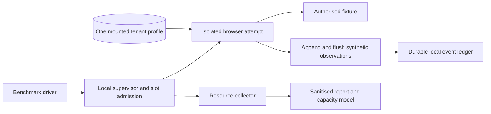
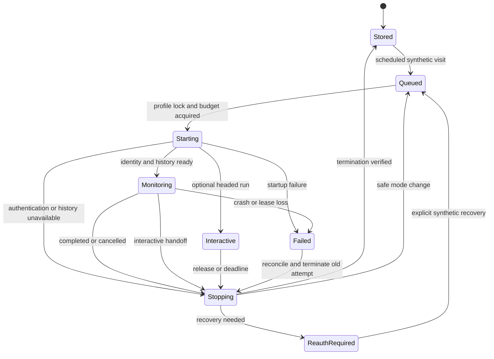

> Implementation status: all 27 experiment tasks are complete; the change remains unarchived. See the [measured results and fixture-only GO decision](../../../docs/research/bounded-browser-lifecycle.md) and [capacity projections](../../../docs/research/bounded-browser-capacity.md). The planning assumptions below are retained as the original baseline.

## Context

PasarPilot's revised direction is a bounded execution pool with profiles at rest, rather than one resident Chromium per seller. The benchmark must establish lifecycle costs before a production scheduler, trading engine or dashboard exists. Reuse `docs/research/facebook-ui.md`: its separately locked Messenger history and incremental UI loading are risks to investigate later, not functionality that a fixture can prove.

### Evidence recorded during planning

Read-only SSH inspection on 2026-10-26 found:

| Item | Observed value | Interpretation |
| --- | --- | --- |
| Jarlaxle RAM | 7,269 MiB total; 3,999 MiB available | Approximately 7.1 GiB usable; not 8 GiB free |
| CPU | 12 logical threads; Ryzen 5 5500U identified in prior exploration | Concurrency remains memory- and contention-dependent |
| Swap | 4,095 MiB configured; about 82 MiB occupied | Occupancy is not evidence of current thrashing |
| Pressure sample | Memory PSI some/full averages zero; two live vmstat intervals had zero swap-in/out | Short sample only, not a benchmark baseline |
| Minecraft | Java PID 1961461, in the Minecraft-specific tmux scope | PID and scope must be rediscovered at execution time |
| Java memory | RSS 2,577,100 KiB; PSS 2,572,608 KiB; process swap zero | Approximately 2.46 GiB RSS and 2.45 GiB PSS |
| Minecraft scope | `memory.current` 2,633,916,416 bytes; `memory.swap.current` zero | Approximately 2.45 GiB cgroup usage; not additive to RSS/PSS |
| Console | tmux socket label `minecraft`, target `minecraft-tensura-reincarnated:0.0` | Default tmux socket did not find this server |
| Data directory | `/home/aiden/minecraft/servers/tensura-reincarnated` | Never delete, move or edit it for this experiment |
| Container tooling | Docker/Podman not found on the inspected SSH user's PATH | Verify availability and plan runtime setup before execution |

Minecraft was not stopped. No post-stop baseline, browser measurement or capacity result exists. Its memory must not be assumed to become fully available after shutdown: remeasure. The earlier 45-second visit and 2 GiB slot values remain illustrative assumptions.

## Goals / Non-Goals

**Goals:** Establish isolated profile restoration, memory reclamation, lifecycle timing, failure recovery and realistic throughput on Jarlaxle. Produce a reproducible decision with an explicit evidence classification for each answer.

**Non-Goals:** Facebook access, real accounts, production authentication, trading/payment logic, AI calls, billing, a dashboard, continuous remote viewing, multi-host profile migration, a production queue or scheduler, and optimisations that disable sandboxing or site functionality. A pass does not prove Messenger recovery or permit Meta automation.

## Decisions

### 1. Host preparation precedes all browser runs

Capture at least 60 seconds of RAM/MemAvailable, CPU, swap counters and memory PSI with the existing workload intact. Identify Minecraft from its process, owning cgroup, working directory and console/controller; do not infer identity from `java` alone. Record PSS/RSS and cgroup memory, with metric units and shared-accounting caveats. Do not collect environment variables, arbitrary command lines, console history or server credentials.

If still running, show the owner the identified target and proposed stop action, and obtain explicit confirmation. Approval to create this proposal is not approval to stop Minecraft. Alternatively, the owner can stop it directly.

The currently observed owner-facing route is `ssh -t jarlaxle 'tmux -L minecraft attach -t minecraft-tensura-reincarnated'`. Revalidate that this remains the correct Minecraft console. The owner checks current players and, when ready, enters the Minecraft console command `stop`, allowing world saves and normal exit. Do not send `stop` to an unverified shell pane; do not kill the tmux session, use SIGKILL, delete volumes, disable restart policies or change server configuration. If a wrapper restarts it or it cannot stop cleanly, stop preparation and consult the owner rather than escalating to a destructive action.

Verify the server process and its descendants have exited and do not restart during the second baseline. Record a second 60-second sample and its time. If Minecraft was already stopped, record that state and capture the current idle baseline; do not fabricate a stop or a recovered-memory delta. Record unrelated service state sufficiently to show no intentional changes, without publishing service secrets.

Only after runtime setup, fixture startup and collector startup, capture a warmed idle baseline for admission and reclamation comparisons. Record the runtime's own overhead separately. Minecraft remains stopped during comparisons; restoring it later is an owner decision, not an automatic cleanup step.

### 2. One host, one slot, fresh container per rotated visit

Use a small TypeScript/Playwright harness, a local controlled fixture and a local supervisor. Use one available container runtime, with a dedicated cgroup and fresh container/process tree per rotated visit. Do not maintain a Chromium process that changes tenant contexts. Keep images and filesystem caches warm instead. Verify non-root Chromium sandbox operation; if the runtime cannot support it, report a blocker rather than launch unsandboxed.

The continuous arm keeps exactly one synthetic browser alive between visits. It is an explicit comparison control, not the proposed seller architecture. The rotation arm permits one browser at a time across three profiles. The default maximum is one in every startup and failure path; optional tests explicitly set two or four after admission.

Do not install PostgreSQL merely for this benchmark. Use an append-only, flushed local ledger and persisted attempt metadata; record schema/version, tenant ID, event ID, source revision, attempt generation and observation time. These records have PostgreSQL-compatible identifiers and transaction boundaries for a later pg-boss implementation, but local files do not claim production database atomicity or distributed lease semantics. No generic job adapter framework is required.

### 3. Persist whole profiles and inspect synthetic storage

Create three dedicated profiles on persistent local storage. Mount only the selected profile and a minimal attempt output directory; never all tenant profiles or the container-management socket. Profile roots are owner-only and outside version control. Validate tenant IDs against the known synthetic set and reject path escape/symlink substitutions.

Seed each fixture identity once. The fixture exercises a persistent authenticated session cookie, local storage and IndexedDB, plus a per-tenant marker and durable sequence counter. Each clean revisit asserts the expected identity and previous counter before updating it; do not silently reseed missing state. Report pass/fail and tenant-neutral metrics, not cookies or storage dumps. Pin and record browser, Playwright, runtime and OS versions and any key-store prerequisites. Profiles remain on Jarlaxle.

A fixture-expired session and a separately unavailable-history state must be distinguishable from an empty inbox. Simulate these states in the fixture; do not claim that this tests actual Messenger cryptographic storage. A bounded optional fixture action can simulate an uncertain outgoing operation; no real message is sent.

### 4. Minimal ownership and crash recovery

Use one local supervisor and a host-level exclusive `flock` per profile, outside Chromium's own files. Hold the lock through browser termination. Persist a generation-numbered lease/attempt record containing tenant, run/attempt ID, process/container identity, requested mode, expiry and cancellation state. Every operation and event append checks the current generation and lease. Use a heartbeat; default lease duration 30 seconds, renewed every 5 seconds. Loss of ownership prevents further actions and initiates shutdown.

An expiry is a reason to reconcile, not permission to open another browser. A supervisor can die while its container survives and its host lock is released. On recovery, inspect experiment-labelled containers/cgroups and stop the previous attempt, verify it is empty, then advance ownership and relaunch. If termination cannot be proved, mark the profile unavailable. Never remove Chromium singleton files just because a lease expired. Do not use PID alone: bind PID/start time or a unique container identity to the attempt.

Cancellation/revocation first blocks new actions, then asks for graceful shutdown. Wait up to 15 seconds; terminate remaining experiment-owned process descendants if needed and verify the cgroup/container is empty. A forced browser stop is recorded as an injected or unexpected crash; it is never used to stop Minecraft. A synthetic action with uncertain completion is recorded for reconciliation, not repeated automatically.

Persist the stopping reason and next state. The host lock remains held through a mode handoff, or the same generation is explicitly reacquired after confirmed termination. Interactive and automated control are mutually exclusive. A new supervisor must reconcile old ownership before scheduling any work.

### 5. Resource admission and stop conditions

All limits below are provisional experimental policy, declared in the run manifest before starting. They are not measurements or production requirements.

- Let `A` be the minimum MemAvailable over the warmed 60-second baseline.
- Reserve `G = max(1 GiB, 15% of MemTotal)` for host safety.
- Reserve another `F = 1.5 GiB` for a future application/database not running in this experiment. If already represented by a measured deployed workload, record that fact rather than subtracting it twice.
- The aggregate browser budget is at most `max(0, A - G - F)`. Do not count swap as capacity. Account for the fixture, collector, runtime and supervisor in the warmed baseline, and extra display components in the browser admission envelope.
- Bootstrap one isolated browser only when a provisional 2 GiB browser cap fits that budget. Otherwise report blocked preparation and seek an explicitly reviewed smaller experiment or additional headroom; do not assume a small browser is safe without evidence.
- After a successful single-slot pilot, set each tested mode's allowance to at least 125% of its observed maximum whole-attempt cgroup memory, rounded up to 64 MiB. Include startup peaks, controller and display/VNC descendants. Recheck admission before every launch; the allowance must fit the current host envelope as well as the configured concurrency ceiling.
- Set and verify container memory/CPU/swap controls. A soft reservation is not a hard cap. Initially disallow browser swap; host swap policy is left untouched. OOM is a failed visit, not a memory-saving success. Use a fixed declared CPU cap for comparisons and report throttling.
- Sample at one-second intervals plus lifecycle boundary samples; preserve cgroup peak counters where supported. Pause admission and stop the arm if MemAvailable remains below `G` for three consecutive samples, memory PSI `full avg10` reaches 1% for ten seconds, or swap-out exceeds 1 MiB/s averaged over ten seconds. Abort on any OOM or sandbox/isolation violation. Record baseline pressure and counter deltas, excluding vmstat's initial since-boot row from interval rates.

Do not tune host sysctls, drop filesystem caches, add zram, disable sandboxing, disable service workers, or stop unrelated services to improve a result. Low pressure rather than a high `free` number is the relevant safety signal.

### 6. Reproducible comparison and measurements

Record the revision, fixture workload, software versions, host baselines, caps, target cadence, timeouts, collector resolution, profile seeds and warm-up exclusions in a run manifest. Default to four sequential fixture targets per visit, with deterministic bounded event extraction. Use the same target count, content size, page behaviour and start-to-start cadence in both arms. Use a declared 60-second cadence by default; overruns start late without overlap and are reported. Do not invent Facebook-like timing from fixture timing.

Primary protocol:

1. Single-slot pilot verifies instrumentation, safety and storage assertions before the full comparison.
2. Arm A: one browser/profile remains running for at least 100 completed visits. Record retained memory between visits and an additional five-minute idle segment.
3. Shut down A and verify cleanup; capture a fresh comparable baseline.
4. Arm B: at least 100 completed fresh-process visits, round-robin over three profiles, at least 33 per tenant. Record startup/restoration failures as failures, not excluded warm-ups. Follow with a five-minute settled reclamation sample.
5. Keep deliberate fault injections separate from the clean comparison denominator: at least five crash/restart cases, an occupied-profile rejection, stale lease with surviving browser, supervisor restart, cancellation/revocation, fixture authentication expiry, missing history and an uncertain synthetic action. Kill only experiment-owned processes. Recovery begins only after old-process termination is established.
6. If resource exhaustion, excessive duration or instability makes 100 visits unsafe/impractical, stop, preserve partial evidence and return INCONCLUSIVE or NO-GO as appropriate. Do not downgrade the count silently.

Measure browser launch-to-ready, fixture authenticated-ready, inspection, observation flush, graceful/forced shutdown and complete slot-occupancy durations independently. Also report end-to-end start-to-start cadence and startup failure/cleanup time. Distinguish launch-cold (new process, warm OS caches) from actual cold-cache results; do not evict caches from the shared host.

Collect whole-attempt cgroup `memory.current`, `memory.peak`, `memory.stat` anon/file/kernel categories, CPU usage/throttling, swap and OOM events where supported. Integrate sampled memory over wall time to compare memory-time costs, including the continuous arm's idle periods. Sample process-tree RSS/PSS for explanation; never add RSS and PSS together or sum RSS as unique physical memory. Record host MemAvailable, CPU, swap-in/out and memory PSI, profile logical/allocated disk bytes, and instrumentation gaps. Disk/profile measurement happens at quiescent boundaries. Count crash-profile growth and runtime/image storage separately.

If kernel peak accounting is unavailable, disclose sampled maxima and their blind spots. Cgroup/process-tree accounting must still be demonstrated; missing mandatory evidence prevents a GO. A capability check must precede any reliance on a particular cgroup file.

Reclamation acceptance requires zero live experiment browser descendants and released ownership after every rotated visit. At final quiescence compare five-minute baseline medians: MemAvailable deterioration must be no more than `max(256 MiB, 10% of one slot allowance)`, and sampled anonymous/residual memory across visit batches must not show unexplained sustained growth. File cache alone is not a leak. If unrelated host activity prevents attribution, mark reclamation INCONCLUSIVE and repeat under a quieter baseline. Never force cache eviction to pass.

Optional experiments follow the passing single-slot protocol. Admit two and then four slots only if their aggregate measured allowances and live headroom fit; record skipped tests with the failed admission condition. Test distinct profiles concurrently and reject same-profile launches. Create a fourth synthetic identity/profile only for an admitted four-slot experiment; keep it outside the primary three-profile rotation dataset. Compare headed Chromium with display overhead, then temporary noVNC with zero/one viewer. Background plus interactive concurrency is tested only if both fit. No active authenticated browser contexts are shared across tenants.

### 7. Browser-free processing boundary

Flush synthetic observations before releasing the browser. The driver demonstrates that a browser-free consumer can read the durable ledger after termination. It does not implement business decisions, AI or a general-purpose queue. A later outgoing job carries source revision, policy/order version and ownership generation, and must reacquire the profile and refresh external state before acting. Simulate stale revision rejection and uncertain completion only against the fixture. Do not wait for OpenRouter while occupying a slot.

Normal operation is dashboard-driven in future. Sellers can view Facebook on their own devices; this does not authenticate the server profile. Initial authentication/recovery remains temporary interaction, available independently of a future premium tier. Headless Chromium cannot be turned into a noVNC desktop in place: close it, retain exclusive profile ownership, start a headed instance on a virtual display, and attach protected VNC temporarily. Charge all display/streaming memory to the admitted mode; no parallel headless browser remains during handoff. Real seller login is outside this change.

### 8. Capacity model and decision report

Separate measured results, provisional policies, calculated projections and future production requirements in the report. Provide median, p95 and maximum timings/memory, counts and denominators, first versus later visit costs, and missing evidence. Always show complete/partial coverage and all failure attempts.

For each active seller interval `I` in 2/5/10/15 minutes, model 5/20/50/100 active sellers. For `c` in 1/2/4 slots, use:

- `D`: measured mean browser-occupied seconds per successful observation, including amortised failed-attempt, retry and cleanup occupancy; do not double-count retry overhead already measured.
- `O`: additional outgoing-browser visits per successful observation, with measured fixture action occupancy `D_action` or explicitly assumed values if not measured.
- `H`: interactive browser-seconds consumed per wall-clock hour, zero in the primary comparison.
- `available_slot_seconds_per_hour = max(0, 3600*c - H)`.
- `budgeted_observations_per_hour = 0.70 * available_slot_seconds_per_hour / (D + O*D_action)`.
- `required_observations_per_hour = 3600*N/I`; utilisation uses the same workload and available slot-seconds.
- Budgeted minimum interval is `3600*N / budgeted_observations_per_hour`; monthly browser-hours per seller use 720 hours and the same effective service demand.

Run sensitivities for `O=0`, `0.25` and `1`; additional retry rates 0/5/15% with a stated retry-cost assumption; and one ten-minute interactive session per hour (600 slot-seconds). Show raw stability limits separately from the 70% planning policy. Do not extrapolate measured single-slot timings as proof of two/four-slot performance. Memory predictions use aggregate allowances; registered-but-inactive accounts consume storage, not scheduled browser visits.

For staggered constant-duration work, report ideal queue wait as near zero only below capacity. Also model synchronised due times and the measured duration distribution with a deterministic seeded offline schedule calculation. Report mean/p95 queue wait and detection delay, explicitly stating the assumed arrival model; at sustained utilisation >=100%, label delay unbounded rather than inventing a finite estimate. Approximate detection delay includes interval residual wait, queue wait and source-inspection time. State that fixture results are neither Facebook freshness guarantees nor a subscription SLA.

The report answers all eight proposal questions and concludes:

- **GO for a bounded fixture scheduler next:** both primary arms complete >=100 visits and at least 99% of planned clean visits succeed on their first attempt; zero isolation/ownership breaches; all clean rotation persistence/identity assertions pass without reseeding; every declared injected failure recovers safely; resource and reclamation criteria pass; mandatory evidence is available; and one admitted slot can project at least five active sellers at 15-minute intervals under the 70% policy. Report the planned-visit, first-attempt success and retry counts separately. That workload target and reliability threshold are provisional pilot policies, not validated customer demand or production SLAs. Two/four slots need not pass to establish a one-slot GO.
- **NO-GO for the tested configuration:** a demonstrated isolation violation, unrecoverable profile loss, persistent resource/reclamation failure, failure to meet the declared first-attempt reliability threshold or inability to meet that declared pilot target. Document whether lifecycle correctness passed but throughput did not. Recommend a narrower target, different resource allocation or another bounded experiment; do not pivot automatically to a production architecture.
- **INCONCLUSIVE:** preparation/approval blocked, missing accounting, unsafe/incomplete visit counts without a demonstrated design failure, or excessive host noise. State exactly what evidence is missing.

If any safety failure stops a run, record it even when later conditions improve. A valid NO-GO/INCONCLUSIVE report can complete this experimental change; it cannot authorise production implementation. The production Meta permission, Facebook profile/history and external send-reconciliation gates remain unresolved.

## Risks / Trade-offs

- [Fixture differs from Facebook] -> Report a lifecycle result only; retain the live-platform authorisation and restoration gates.
- [Startup outweighs saved idle memory] -> Compare occupied seconds, idle memory and total memory-time; consider measured same-tenant warm retention only in a later change.
- [Host workload contaminates measurements] -> Paired baselines, pressure counters, recorded run order and an INCONCLUSIVE outcome instead of forced attribution.
- [Crash interrupts a storage write] -> Define persistence guarantees at completed/flushed task boundaries, test recovery, and never silently recreate a missing profile.
- [Local lease files are insufficient for distributed execution] -> Pin this harness to one supervisor/host; specify a future PostgreSQL lease and job design separately.
- [Container tooling absent or sandbox incompatible] -> Treat environment setup as a recorded prerequisite; do not weaken isolation to proceed.
- [Polling cannot recover deleted or unavailable events] -> Carry coverage limitations into subsequent product proposals; no auction or real-time guarantees.

## Migration Plan

There is no application or schema migration. During implementation, create a dedicated benchmark workspace and experiment-labelled runtime resources. Stop only experiment resources on rollback, preserve Minecraft data/configuration, and retain sanitised evidence. Remove synthetic profiles through an explicit scoped cleanup after results are accepted; never use broad container/volume pruning. Restore Minecraft only at the owner's direction. Do not change existing OpenSpec main specs until normal completion/archive workflow.

## Open Questions

- What runtime and privileges can Jarlaxle support while retaining Chromium sandboxing?
- How much memory is available after an owner-approved Minecraft stop and runtime setup?
- Do measured profile sizes, visits and fault recoveries fit the initial resource envelope?
- Is the provisional five-active-sellers/15-minute pilot target commercially useful, or should a later proposal change it explicitly?
- What additional authorised evidence will eventually validate Facebook/Messenger restoration? This change cannot answer that question.

## Technical References

- [Playwright persistent profiles](https://playwright.dev/docs/api/class-browsertype#browser-type-launch-persistent-context)
- [Playwright storage snapshots](https://playwright.dev/docs/api/class-browsercontext#browser-context-storage-state)
- [Chromium profile structure](https://chromium.googlesource.com/chromium/src/+/HEAD/docs/user_data_dir.md)
- [Docker resource limits](https://docs.docker.com/engine/containers/resource_constraints/)
- [Linux cgroup accounting](https://www.kernel.org/doc/html/latest/admin-guide/cgroup-v2.html)
- [pg-boss job lifecycle, for future integration](https://github.com/timgit/pg-boss/blob/master/docs/api/jobs.md)
